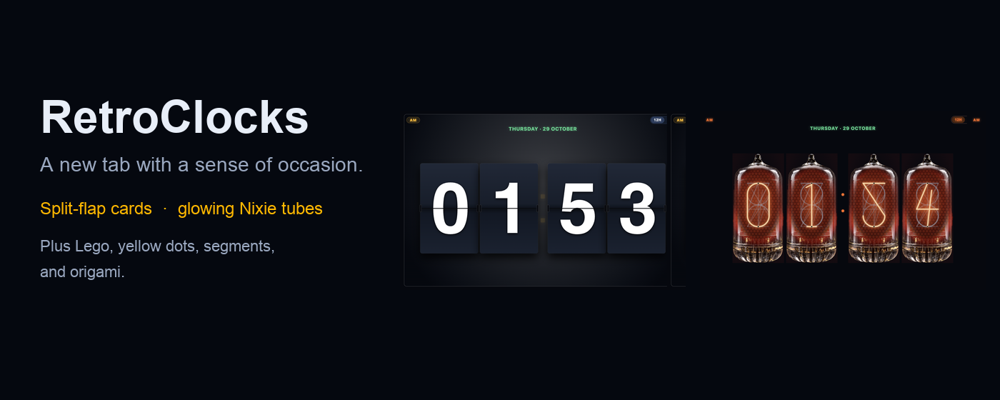
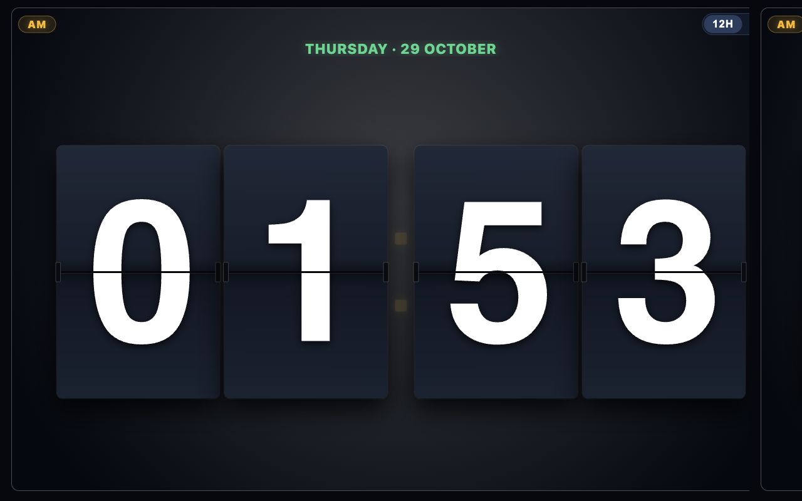
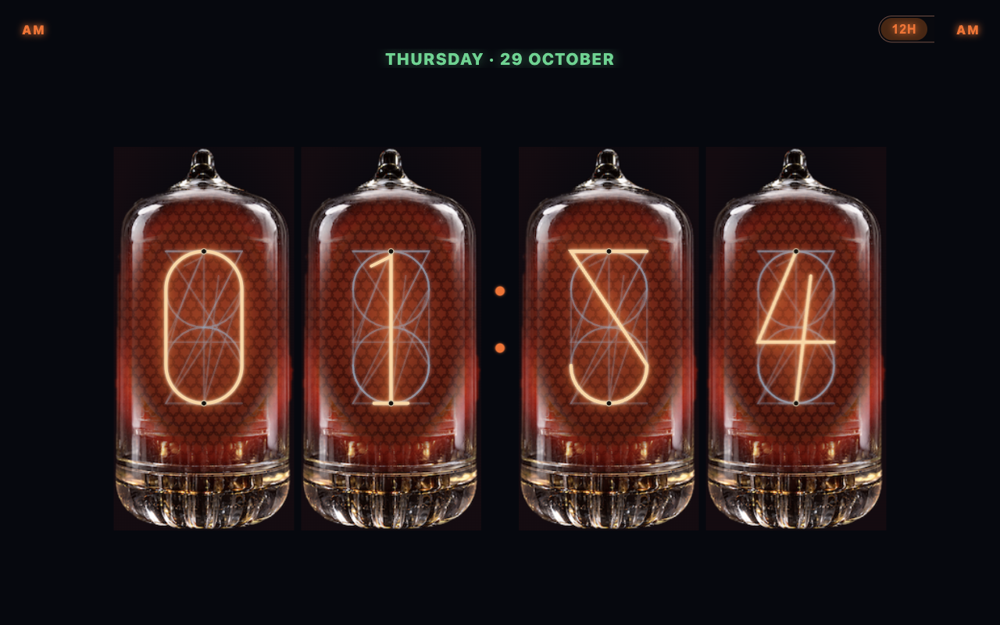
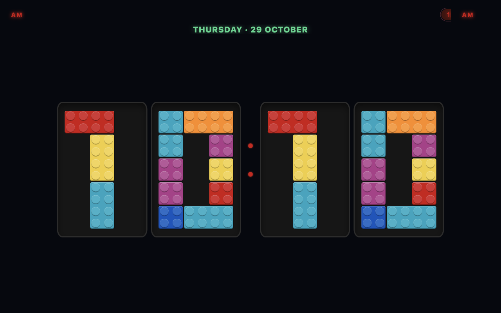
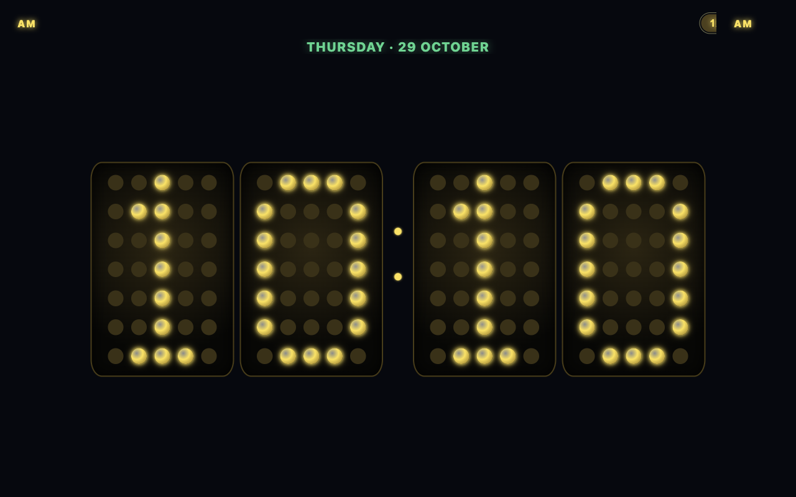
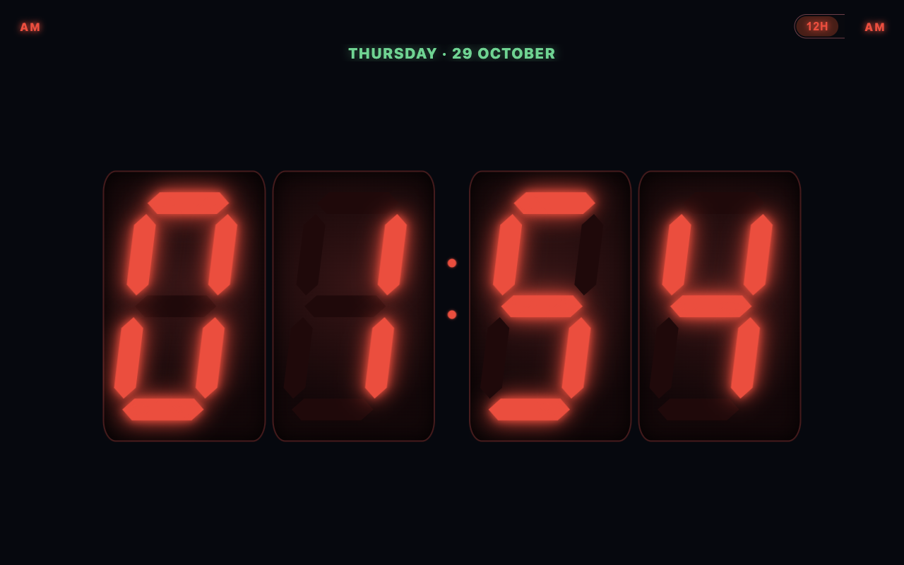

# RetroClocks

  

  <strong>A Chrome new tab clock with a sense of occasion.</strong> 
  Split-flap cards and glowing Nixie tubes, plus Lego, yellow dots, segments, and origami.

  
  
  

  

RetroClocks replaces Chrome’s new tab with a retro clock. The two faces it leads with are a split-flap board and Nixie tubes. The same clock can also show seven-segment digits, yellow dots, Lego bricks, or origami.

Hours and minutes, optional seconds, and the date. Click the clock and the digits scramble, then land back on the time.

## Split-flap and Nixie

| Split-flap | Nixie tubes |
| --- | --- |
|  |  |

**Split-flap.** Four mechanical cards, a gold colon, and a flap sound you can turn on. Each card that flips plays the next strike, alternating two short recordings in [`sounds/flap/`](sounds/flap/). Sound stays off until you turn it on.

**Nixie tubes.** The same time, glowing inside glass. White numbers stay neon orange. Faint wires of the other digits stay visible behind the lit numeral.

## The other faces

| Lego | Yellow dots | Seven-segment |
| --- | --- | --- |
|  |  |  |

Origami is the sixth face: digits folded from blue paper. Store shots for the five faces above are in [`store/`](store/).

## Settings

Settings fill the browser window, with a live preview beside the tabs.

| Tab | What you set |
| --- | --- |
| Clock | Face and size. Flap sound appears when the face is split-flap |
| Time & date | 12-hour or 24-hour, seconds, colon blink, timezone, and the date |
| Look | Background, number, and colon colours. A colour for each digit on seven-segment, origami, and Lego |
| About | Author, export, and import of a settings file |

Chrome lets one extension own the new tab. If another new-tab clock is installed, choose which one you want under `chrome://extensions`.

---

## Privacy

The extension uses the storage permission only. It does not collect accounts, browsing history, or analytics. It does not phone home. Settings stay in Chrome sync, or on this computer. An exported settings file stays where you save it.

Full text: [PRIVACY.md](PRIVACY.md) · [privacy.html](privacy.html)

Store privacy policy URL:

https://github.com/markusvankempen/chrome-retro-clocks/blob/main/PRIVACY.md

---

## Get the extension

Current version: **1.1.0** — see [CHANGELOG.md](CHANGELOG.md). The store package is attached to the [1.1.0 release](https://github.com/markusvankempen/chrome-retro-clocks/releases/tag/v1.1.0).

Install from the Chrome Web Store when the listing is live. This repository is the homepage, privacy policy, licence, icons, and store assets.

**Homepage:** [github.com/markusvankempen/chrome-retro-clocks](https://github.com/markusvankempen/chrome-retro-clocks)  
**Author:** [github.com/markusvankempen](https://github.com/markusvankempen) · [markusvankempen.github.io](https://markusvankempen.github.io/)

---

## Author

**Markus van Kempen**

No bug 🐛 too small, no syntax too weird

https://markusvankempen.github.io/

---

## Licence

[Apache 2.0](LICENSE) — Copyright (c) 2026 Markus van Kempen.
